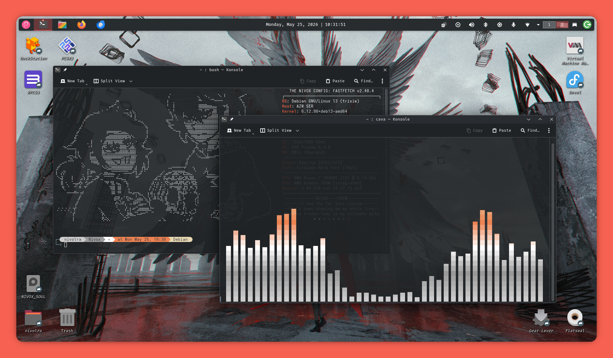
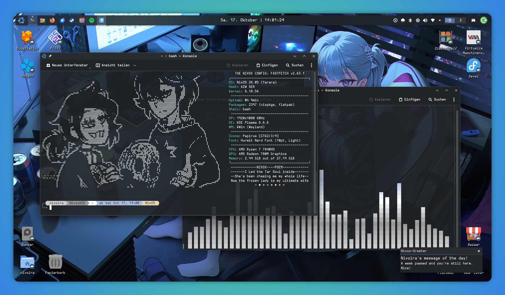
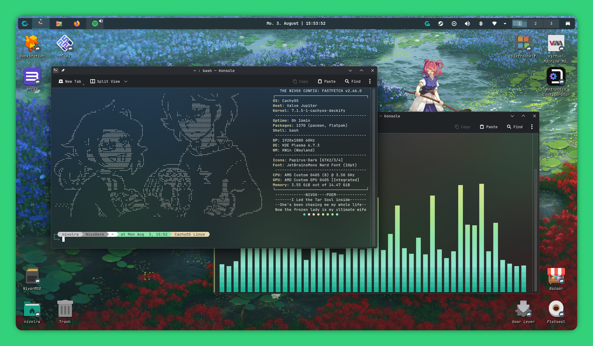

# Nivox-Themes

Remixes and Configurations for various applications, made to personalise your desktop with sensible defaults.

> [!NOTE] Disclaimer
> I typically build my rices on top of existing themes and icon sets that are well supported. I do NOT create my own themes from scratch in the traditional sense. I mostly do remixes, and nothing more.

Nivox - Your Voice. Meaning choice, expression and freedom over your own desktop.

---
## Roadmap

My current goals include...

- Release Main Remixes (Niventure, Nivocal, Nivoid)...
- Expand upon the Nivox Modules with useful functionality (Helper commands, etc.)
- Create a setup script to make Remixes easily re-producable across setups.
### Nivoid Preview

### Nivocal Preview

### Niventure Preview

